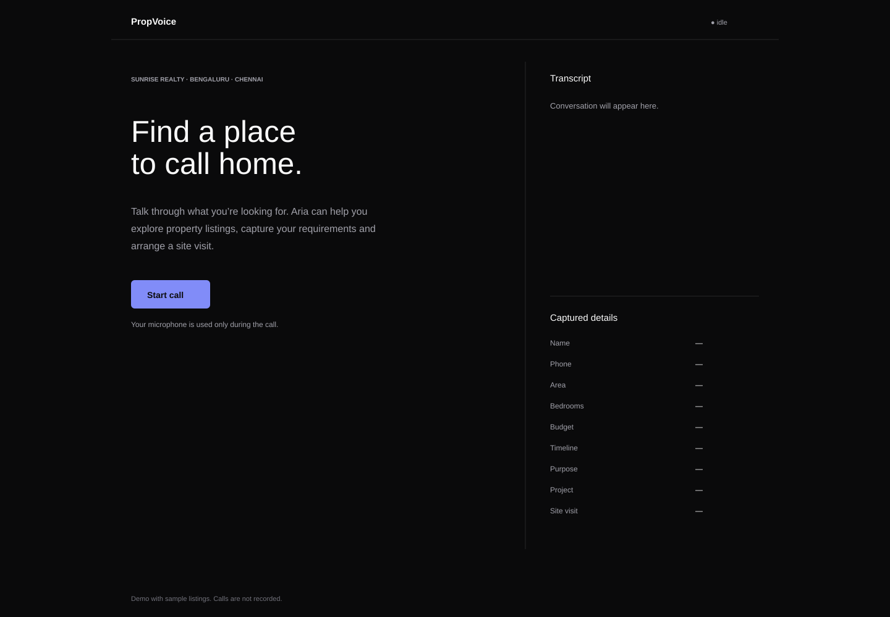
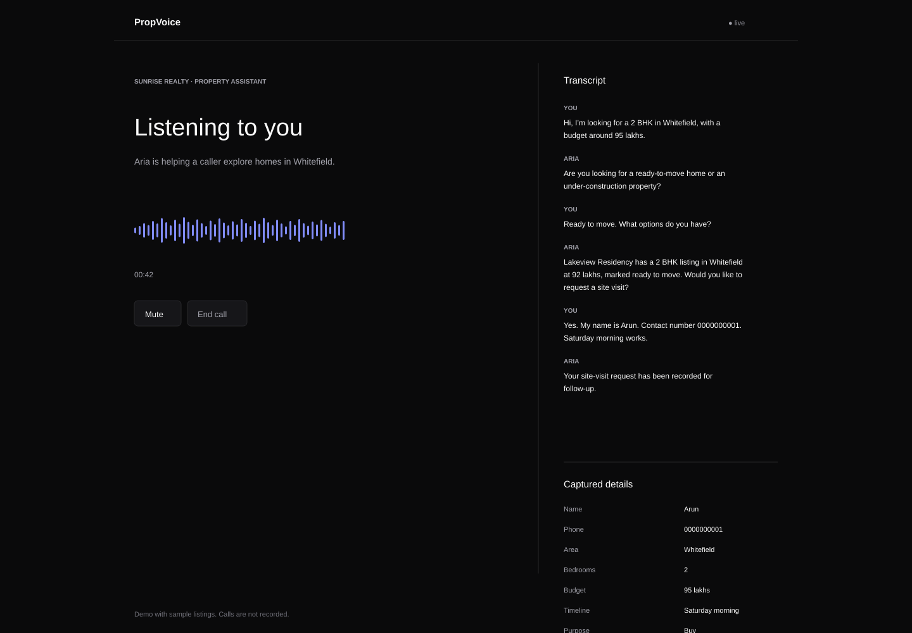
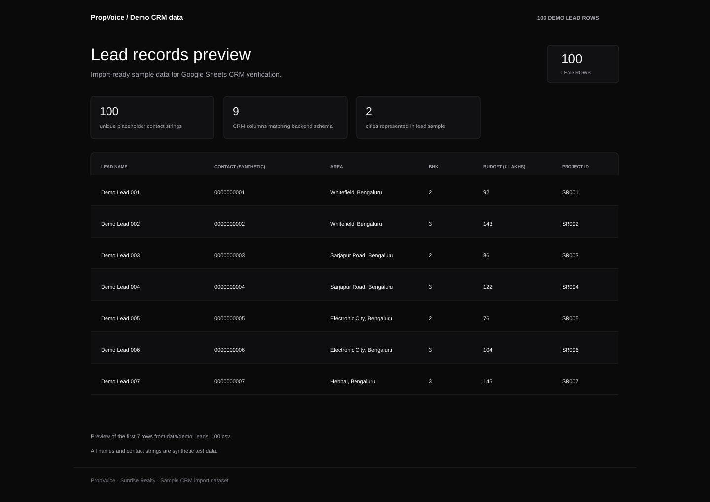
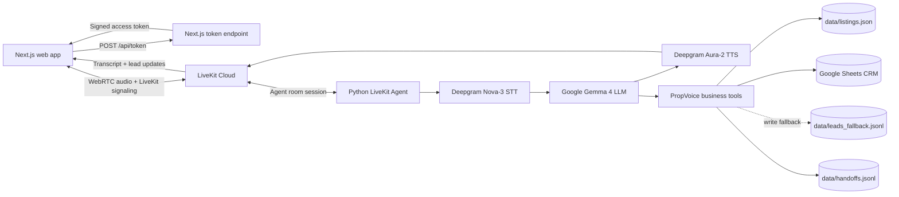

# PropVoice — AI Real Estate Voice Assistant

**A voice-first property discovery and lead qualification platform for Sunrise Realty.** PropVoice connects a browser-based calling interface to an AI voice agent named **Aria**. Callers can describe the home they are looking for, explore matching listings, share their requirements, and request a site visit. Captured lead information is sent to a Google Sheets CRM.

<p align="center">
  
</p>

<p align="center"><em>PropVoice home interface</em></p>

## Demo Screenshots

| Conversation interface | CRM lead dataset preview |
|---|---|
|  |  |

The conversation image uses representative sample dialogue to show the transcript and captured-details panels. The CRM preview is generated from the included CSV demo dataset.

## What PropVoice Does

- **Voice conversations:** Callers speak naturally through the web application; Aria responds with generated speech.
- **Property discovery:** Search the property catalogue by city or locality, bedroom count, and maximum budget.
- **Lead qualification:** Gather buyer name, phone number, preferred area, BHK, budget, timeline, and purpose.
- **Site-visit requests:** Capture the selected project, caller details, and preferred visit time for follow-up.
- **CRM capture:** Append lead and site-visit records to a Google Sheets worksheet.
- **Reliable local record keeping:** Save lead or visit data to a local JSONL fallback file when the Sheets write fails.
- **Human follow-up:** Record callback requests in a separate handoff log.
- **Live call workspace:** Show the conversation transcript and lead details while the call is in progress; provide mute and end-call controls.

## Demo Data

The repository includes a ready-to-import demo dataset:

| Dataset | Records | Description |
|---|---:|---|
| Lead records | **100** | Synthetic CRM rows with distinct placeholder contact strings |
| Bengaluru properties | **15** | Sample residential listings |
| Chennai properties | **10** | Sample residential listings |
| **Total demo records** | **125** | Across CRM and property inventory |

- `data/demo_leads_100.csv` contains 100 synthetic lead rows and the same nine fields written by the backend.
- `data/listings.json` contains 25 property records across Bengaluru and Chennai.
- Property names, prices, availability, names, and phone strings in the demo data are examples for application demonstration and testing, not verified third-party inventory or real customer details.

### Google Sheets CRM columns

The backend appends records using this exact column order:

```text
created_at, type, name, phone, area, bhk, budget_lakhs, project_id, notes
```

To inspect the sample lead records, import `data/demo_leads_100.csv` into a new Google spreadsheet. Keep this demo sheet separate from any real customer CRM.

## Architecture



### Request and conversation flow

1. The caller selects **Start call** in the Next.js interface.
2. The frontend requests a short-lived LiveKit access token from `/api/token`.
3. The token endpoint signs the participant token on the server and configures dispatch for the `my-agent` worker.
4. The browser joins a LiveKit room. The Python agent joins the same room and starts the voice session.
5. LiveKit Agents coordinates speech-to-text, the language model, tool execution, turn handling, and text-to-speech.
6. Aria uses the application tools to search listings, save a lead, record a site-visit request, or log a callback request.
7. Approved lead fields and transcript events are reflected in the browser workspace.

## Technology Stack

| Layer | Technology |
|---|---|
| Frontend | Next.js 15, React 19, TypeScript, Tailwind CSS v4 |
| Real-time audio | LiveKit Cloud, WebRTC, LiveKit React Components |
| Agent runtime | Python, LiveKit Agents |
| Speech-to-text | Deepgram Nova-3 through LiveKit Inference (`en-IN`) |
| Language model | Google Gemma 4 31B Instruct through LiveKit Inference |
| Text-to-speech | Deepgram Aura-2 (`thalia`) through LiveKit Inference |
| Turn handling | LiveKit turn detector and AgentSession |
| Audio enhancement | AI-Coustics QUAIL VF-S through the LiveKit plugin |
| CRM | Google Sheets API via `gspread` |
| Local data | JSON property catalogue and JSONL event/fallback logs |
| Python tooling | `uv`, `pytest`, `ruff` |

## Repository Structure

```text
propvoice-realestate-voice-agent/
├── data/
│   ├── listings.json              # Bengaluru + Chennai property catalogue
│   └── demo_leads_100.csv         # 100 synthetic CRM rows for import
├── docs/
│   └── screenshots/               # Interface and demo data screenshots
├── src/
│   ├── agent.py                   # LiveKit voice agent and model pipeline
│   ├── prompts.py                 # Aria persona and conversation rules
│   └── tools.py                   # Search, lead, visit, CRM and handoff tools
├── tests/
│   ├── test_agent.py
│   └── test_tools.py
├── web/
│   ├── app/
│   │   ├── api/token/route.ts      # Server-side LiveKit token endpoint
│   │   ├── page.tsx                # Calling interface and live transcript
│   │   └── globals.css
│   └── package.json
├── .env.example
├── pyproject.toml
└── README.md
```

## Getting Started

### Prerequisites

- Python 3.10 or later
- Node.js 20 or later and npm
- [`uv`](https://docs.astral.sh/uv/)
- [LiveKit Cloud](https://cloud.livekit.io/) project and LiveKit CLI (`lk`)
- Google Cloud service account with the Google Sheets API enabled (for CRM writes)

### 1. Configure the Python agent

From the repository root:

```bash
uv sync
cp .env.example .env.local
```

Fill the root `.env.local` file:

```dotenv
LIVEKIT_URL=wss://YOUR_PROJECT.livekit.cloud
LIVEKIT_API_KEY=YOUR_LIVEKIT_API_KEY
LIVEKIT_API_SECRET=YOUR_LIVEKIT_API_SECRET
GOOGLE_SHEET_ID=YOUR_GOOGLE_SPREADSHEET_ID
GOOGLE_SERVICE_ACCOUNT_FILE=service_account.json
```

Place the Google service account JSON key at the path specified by `GOOGLE_SERVICE_ACCOUNT_FILE`. Share the target Google spreadsheet with the service account email address and grant Editor access. Keep credentials and service-account files out of Git.

Authenticate the LiveKit CLI:

```bash
lk cloud auth
```

### 2. Configure the web application

Create `web/.env.local`:

```dotenv
LIVEKIT_URL=wss://YOUR_PROJECT.livekit.cloud
LIVEKIT_API_KEY=YOUR_LIVEKIT_API_KEY
LIVEKIT_API_SECRET=YOUR_LIVEKIT_API_SECRET
```

The API secret is used only by the server-side token route. Do not expose it through a `NEXT_PUBLIC_` variable.

### 3. Start the agent and frontend

**Terminal 1 — Python agent, from the repository root:**

```bash
lk agent dev --deployment local
```

**Terminal 2 — Next.js frontend:**

```bash
cd web
npm install
npm run dev
```

Open [http://localhost:3000](http://localhost:3000), allow microphone access, and select **Start call**.

## Demo Walkthrough

Try these example requests during a call:

- “I am looking for a 2 BHK in Whitefield with a budget up to 100 lakhs.”
- “Show me properties in Chennai.”
- “Find a 3 BHK in OMR for less than 125 lakhs.”
- “I would like to request a visit to Lakeview Residency on Saturday morning.”
- “Please save my details for a follow-up.”

For a site-visit request, Aria collects the project, caller name, a valid phone number, and a preferred time before invoking the booking tool.

## Testing and Code Quality

Run the Python unit tests from the repository root:

```bash
uv run pytest
```

Run Ruff linting and formatting checks:

```bash
uv run ruff check .
uv run ruff format --check .
```

Check the frontend TypeScript project:

```bash
cd web
npm run typecheck
```

## Data and CRM Notes

- Property prices in `data/listings.json` are expressed in lakhs.
- `area` in the property catalogue is a locality; `city` identifies Bengaluru or Chennai.
- The property search tool accepts a locality or city name using its `area` argument, plus optional BHK and maximum budget filters.
- Lead and site-visit writes use the same Google Sheets worksheet and CRM column order shown above.
- When Google Sheets is unavailable, lead and visit records are written to `data/leads_fallback.jsonl`.
- Callback requests are appended to `data/handoffs.jsonl`.
- Demo lead data is synthetic. Do not call the placeholder contact strings or mix the sample rows into a live customer CRM.

## Security

- Keep `.env.local`, LiveKit API secrets, and Google service-account JSON keys private.
- The browser receives a signed, room-scoped access token; the LiveKit API secret remains on the server.
- Use a dedicated test spreadsheet when importing the included demo dataset.

## License

This project is licensed under the MIT License. See [LICENSE](LICENSE).