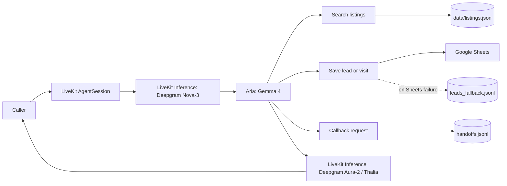

# PropVoice

**Aria** is a voice AI property lead qualifier for **Sunrise Realty**, a fictional Bengaluru broker. She searches a small sample catalog, gathers buyer requirements, and records visit or callback requests.

> Demo video: *Placeholder — add a short Agent Console recording here.*
> Screenshot: *Placeholder — add a PropVoice web demo screenshot here.*

## Problem

Broker teams spend time collecting the same requirements by phone. Aria handles the first conversation, finds catalog matches, and captures qualified leads for follow-up.

## Architecture



## Features

- Voice pipeline using LiveKit Inference, Deepgram Nova-3 (`en-IN`) and Aura-2 (`thalia`), with the starter's Gemma 4 LLM and turn handling.
- Fifteen fictional listings across Bengaluru areas, budgets, and home sizes.
- Property search, validated visit requests, lead capture to Google Sheets with local fallback, and callback logging.
- Guardrails grounded in tool results; one question at a time.
- Unit tests for CRM and tool behavior plus ten conversation scenarios in `scenarios.yaml`.

## What Aria will not do

Aria will not invent listing facts, guarantee discounts, promise loan or legal outcomes, or predict returns. A handoff logs a callback request; it does not transfer a live call.

## Setup

Requires Python 3.10+, `uv`, and the LiveKit CLI. Install dependencies with `uv sync`, then authenticate using `lk cloud auth`. Copy `.env.example` to `.env.local` and fill in the LiveKit URL, key, and secret. Do not commit `.env.local` or service account credentials.

For Google Sheets CRM, create a Google Cloud service account, enable the Google Sheets API, download its JSON key to `service_account.json`, share the target spreadsheet with the service account email as an editor, and set `GOOGLE_SERVICE_ACCOUNT_FILE=service_account.json` and `GOOGLE_SHEET_NAME` in `.env.local`. Never commit the downloaded key.

## Run

Local terminal console (microphone and speaker):

```console
lk agent console
```

Connect to LiveKit Cloud for the Agent Console or a frontend:

```console
lk agent dev
```

Open the [LiveKit Agent Console](https://docs.livekit.io/testing/agent-console/) for interactive browser testing and session traces.

## Tests and results

Run local unit tests with `uv run pytest`. Run the conversation simulations with `lk agent simulate text --scenarios scenarios.yaml --yes` (requires LiveKit Cloud credentials and inference access). Simulation results should be recorded here after a real run; none are claimed yet.

## Failure log

See [docs/failure_log.md](docs/failure_log.md). Only failures reproduced during a scenario run belong there.

## Known limitations

- Listings are fictional static sample data, not live inventory.
- Site visit requests are recorded, not synchronized with a calendar.
- A human callback is logged but no live transfer or callback dispatch is implemented.
- Google Sheets requires a correctly configured service account and network access.

Built on LiveKit Agents' official starter template; persona, tools, CRM integration, guardrails and tests are original work.
